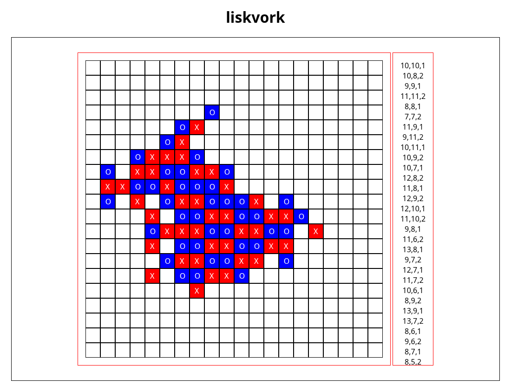

# Gomoku AI

Epitech 3rd-year project: a Gomoku AI that speaks the Gomocup **pbrain** protocol on stdin/stdout.
It uses flat Monte Carlo (50,000 random playouts, 30 moves deep, per move) run on a home-made thread pool (`src/Thread/`: `Mutex`, `ScopeLock`, `ConditionVariable`, `Promise`, `SafeQueue`, `ThreadPool`). Playout scores are summed into a 20x20 matrix and the best empty cell is played.



## Build

```sh
make -j4 CXXFLAGS=-O2
```

This builds `pbrain-gomoku-ai`, plus `pbrain-player1.exe` and `pbrain-player2.exe` (the same binary under the names liskvork expects).

`CXXFLAGS=-O2` is required on GCC 15 or newer. A plain `make` builds at `-O0`, and since GCC 15 libstdc++ then enables `_GLIBCXX_ASSERTIONS`. The AI aborts on its first `TURN` with `Assertion '__n < this->size()' failed`. The cause is a known bug: `src/Board.cpp:139` reads `_tmp[i + dx][j + dy]` before the bounds check (an out-of-bounds read on edge cells that older GCC let through silently). `-O2` also makes a move faster: about 2.7 s on average instead of about 5 s at `-O0`.

## Quick protocol check

```sh
printf 'START 20\nBEGIN\nTURN 11,11\nTURN 9,9\nEND\n' | ./pbrain-gomoku-ai 2>/dev/null
# OK
# 10,10
# 10,11
# 10,9
```

Debug lines (`str_got ...`) go to stderr. The AI also writes `zlog_<name>.txt` in the current directory.

## Run a match with the liskvork web viewer

The repo ships `gomocup`, a prebuilt static binary of liskvork 0.4.3, the game manager. It reads `config.ini` from the current directory, spawns the two players and serves a spectator web page.

```sh
# after building
sed -i -e 's/^address=.*/address=127.0.0.1/' -e 's/^auto_close=.*/auto_close=false/' config.ini
./gomocup
```

Open http://127.0.0.1:3000/. Moves appear live (player 1 = blue `O`, player 2 = red `X`). After the result line, press Enter in the terminal to quit.

Useful `config.ini` keys:

| Key | Repo value | Meaning |
|-----|-----------|---------|
| `timeout_turn` | `5000` | Max ms per move. |
| `player1` / `player2` | `./pbrain-player1.exe` / `./pbrain-player2.exe` | Executables to spawn. Player 1 starts. |
| `board_file` | `./board.log` | Board dump after each move. |
| `board_color` | `true` | ANSI colors in `board.log` (`false` to read it in an editor). |
| `[web] enable` | `true` | Turn the spectator web server on. |
| `[web] address` / `port` | `0.0.0.0` / `3000` | Bind address. Use `127.0.0.1` to keep it local. |
| `auto_start` | `true` | `false` = press Enter to start (lets you open the page first). |
| `auto_close` | `true` | `false` = press Enter to quit, so the page keeps the final board. |

Two copies of this AI rarely make five in a row: games often run to about 400 moves (about 18 minutes).

### Human vs AI

liskvork only spawns two programs and the web page is read-only. To play against the AI, type pbrain commands yourself:

```sh
./pbrain-gomoku-ai 2>/dev/null
START 20
BEGIN          # AI plays first and prints its move, e.g. 10,10
TURN 9,9       # your move as x,y; the AI answers with its move
END
```

Never send a cell that is already taken: the AI throws `Case already played` and aborts.

## Project structure

```
main.cpp
include/               headers (same layout as src/)
src/
├── Core.cpp               run loop
├── ManagerConnection.cpp  stdin/stdout I/O, zlog file
├── Board.cpp              board state, win detection
├── Player.cpp             pbrain command handlers (START, BEGIN, TURN...)
├── Matrix.cpp             20x20 score matrix
├── MonteCarlo.cpp         playouts and move choice
└── Thread/                Mutex, ScopeLock, ConditionVariable, Promise, SafeQueue, ThreadPool
gomocup                liskvork 0.4.3 binary
config.ini             liskvork config
get_liskwork.sh        rebuilds gomocup from liskvork-0.4.3-src.tar.gz with Docker
```

## Pitfalls

- **`make re -j4` races:** `fclean` and `all` run in parallel and can delete the fresh binaries. Run `make fclean`, then `make -j4 CXXFLAGS=-O2`.
- **`get_liskwork.sh`:** its test `[ ! -d liskvork && ! -f $targz ]` is invalid `[` syntax (it prints an error and continues), and its Docker build pins `zig=~0.13` on `alpine:edge`, which may no longer ship Zig 0.13. Use the committed `gomocup` instead.
- **`timeout_turn` vs CPU speed:** the AI runs a fixed 50,000 playouts, not a time budget. A move takes about 3.3 s at `-O2` on 12 cores. On a slower or busy machine, raise `timeout_turn` or the AI loses on time.
- **`auto_close=false` needs an open stdin:** if stdin is `/dev/null` (e.g. from a script), liskvork exits right away. Use `tail -f /dev/null | ./gomocup`.

## Authors

- Ambroise Jacquemet ([@Solype](https://github.com/Solype))
- Hugo Tesson ([@ugeaux](https://github.com/ugeaux))
- Satine Fouque ([@Satineee](https://github.com/Satineee))
